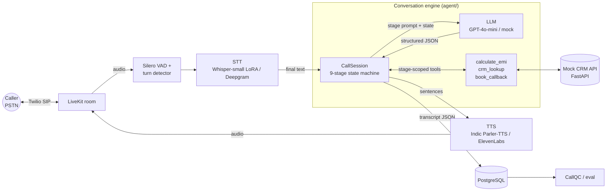

# Vaani

A real-time outbound voice AI agent that runs personal-loan sales calls for an Indian lender in
**English, Hindi and code-mixed Hinglish**.

> **Status: work in progress.** Phase 1 (the conversation engine) works and is tested. The voice
> pipeline, turn-detection experiments and speech-model fine-tuning have their interfaces and plans in
> the repo but are not built yet. See the [roadmap](#roadmap).

## Architecture



Right now, Phase 1 runs everything inside the **Engine** box, driven by a text CLI.

## The call flow

Nine stages, each with its own prompt in [`prompts/`](prompts/), its own allowed tools and explicit
transition rules ([`agent/stages.py`](agent/stages.py)):

```
greeting → consent → need_discovery → eligibility → offer ⇄ objection → commitment → closing
                                                                         ↘ callback ↗
           (callback and closing are reachable from every live stage)
```

The LLM never picks the stage. Each step it returns structured JSON (`reply_text`,
`detected_intent`, `extracted_slots`, `next_stage_suggestion`, optional `tool_calls`), and the engine
checks the suggestion against the transition table and slot guards. For example, the call cannot reach
`offer` until income, employment type and existing EMIs are all known.

### Recovery paths (each covered in [`tests/test_recovery.py`](tests/test_recovery.py))

| Situation | Behaviour |
|---|---|
| Barge-in | Agent turn is cut at the last word actually played; unspoken text is dropped from history and kept as `unspoken_text` in the transcript |
| Dead air > 4 s | Re-prompt once with the last question, then exit gracefully (`no_response`) |
| Off-topic | Short acknowledgement, then steer back to the stage question |
| Amounts | Every amount is read back ("Just to confirm, five lakh rupees?") and only stored after a yes. Corrections like "no, 4 lakh" are handled |
| Language switch | Language is detected on every turn and the agent mirrors it (en / hinglish / Devanagari hi) |
| "Are you a bot?" | Honest AI disclosure, then repeats the pending question |
| Do-not-call / not interested | Deterministic guardrail ends politely; DNC is written back to the CRM |

Prepared objection strategies cover a high interest rate, an existing loan, needing to ask family,
distrust of phone calls and a bad time to talk.

### Transcript format

Text and voice calls share one format ([`agent/transcript.py`](agent/transcript.py), JSON Schema in
[`schemas/transcript.schema.json`](schemas/transcript.schema.json)):
`call_id`, `prompt_version` (content hash of `prompts/`), `turns[{speaker, text, lang, start_ms,
end_ms, stage, intent, interrupted, unspoken_text, metrics}]`, `outcome`, `tool_calls`, `events`.
Voice turns carry latency marks (`user_eos_ms`, `stt_final_ms`, `llm_first_token_ms`,
`tts_first_byte_ms`) that the eval scripts read. Example: [`docs/sample_transcript.json`](docs/sample_transcript.json).

## Quickstart

```bash
python -m venv .venv && source .venv/bin/activate
pip install -e ".[dev,api]"

pytest -q                                          # state machine + recovery tests
python -m agent.cli --phone +919800000001          # chat offline (rule-based mock LLM)
python -m agent.cli --phone +919800000002 --llm openai   # needs OPENAI_API_KEY and pip install -e ".[llm]"

docker compose up                                  # Postgres + mock CRM API on :8000
```

CLI commands: `/silence 5` (simulate 5 s of dead air), `/bargein 20` (interrupt the agent after 20
characters), `/state`, `/quit`. Test customers live in [`tools/crm.py`](tools/crm.py).

## Repo layout

```
agent/            conversation engine: stages, engine, guardrails, language/number/time parsing, CLI
  llm/            LLM interface + OpenAI backend + offline mock
  voice/          sentence chunker, filler policy, pluggable turn detectors, LiveKit worker (stub)
prompts/          base.md + one system prompt per stage
tools/            calculate_emi, crm_lookup, book_callback
crm_service/      FastAPI mock CRM + scheduler
eval/             latency_report.py, talk_over.py, wer.py
finetune/         Whisper-small LoRA + Indic Parler-TTS plans (Phase 4)
db/               Postgres schema for call logs
tests/
```

## Roadmap

- [x] **Phase 1: conversation flow.** 9-stage state machine, structured LLM output, validated
  transitions, stage-scoped tools, every recovery path and objection tested, text CLI, transcript schema
- [ ] **Phase 2: voice pipeline.** LiveKit Agents with streaming STT/TTS, sentence-level TTS streaming,
  barge-in within one frame, latency-triggered fillers, outbound dialing through Twilio SIP.
  *Already done:* sentence chunker, filler policy, barge-in handling in the engine
- [ ] **Phase 3: turn detection + metrics.** VAD-only vs LiveKit turn detector vs a custom model, a
  replay harness with 30+ recorded calls, voice-to-voice latency (median/p95/p99) and talk-over rate.
  *Already done:* the eval scripts and transcript metric fields
- [ ] **Phase 4: speech models.** Whisper-small + LoRA on Hinglish code-switched speech (WER before/after,
  number WER, vs Deepgram) and adapted Indic Parler-TTS (TTFB vs ElevenLabs, blind MOS)

Results go in [RESULTS.md](RESULTS.md). Every number there will come from a script in `eval/`.
