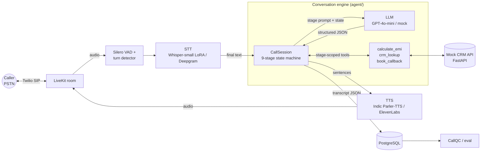

# Vaani

A real-time outbound voice AI agent that runs personal-loan sales calls for an Indian lender in
**English, Hindi and code-mixed Hinglish**.

At its core is a deterministic, fully tested conversation engine. A 9-stage state machine keeps the LLM
on script, validates every stage transition in code, reads back every amount before accepting it, and
recovers from barge-ins, dead air, off-topic answers, language switches and "are you a bot?" moments.


## Architecture



The engine doesn't depend on how the call is carried: one `CallSession` API takes user turns, silence and barge-in events, whether they come from the text CLI or a voice transport.

## The call flow

Nine stages, each with its own prompt in [`prompts/`](prompts/), its own allowed tools and explicit
transition rules ([`agent/stages.py`](agent/stages.py)):

```
greeting → consent → need_discovery → eligibility → offer ⇄ objection → commitment → closing
                                                                         ↘ callback ↗
           (callback and closing are reachable from every live stage)
```

The LLM never picks the stage. Each step it returns structured JSON (`reply_text`,
`detected_intent`, `extracted_slots`, `next_stage_suggestion`, optional `tool_calls`), and the engine
checks the suggestion against the transition table and slot guards. For example, the call cannot reach
`offer` until income, employment type and existing EMIs are all known.

### Recovery paths (each covered in [`tests/test_recovery.py`](tests/test_recovery.py))

| Situation | Behaviour |
|---|---|
| Barge-in | Agent turn is cut at the last word actually played; unspoken text is dropped from history and kept as `unspoken_text` in the transcript |
| Dead air > 4 s | Re-prompt once with the last question, then exit gracefully (`no_response`) |
| Off-topic | Short acknowledgement, then steer back to the stage question |
| Amounts | Every amount is read back ("Just to confirm, five lakh rupees?") and only stored after a yes. Corrections like "no, 4 lakh" are handled |
| Language switch | Language is detected on every turn and the agent mirrors it (en / hinglish / Devanagari hi) |
| "Are you a bot?" | Honest AI disclosure, then repeats the pending question |
| Do-not-call / not interested | Deterministic guardrail ends politely; DNC is written back to the CRM |

Prepared objection strategies cover a high interest rate, an existing loan, needing to ask family,
distrust of phone calls and a bad time to talk.

### Transcript format

Text and voice calls share one format ([`agent/transcript.py`](agent/transcript.py), JSON Schema in
[`schemas/transcript.schema.json`](schemas/transcript.schema.json)):
`call_id`, `prompt_version` (content hash of `prompts/`), `turns[{speaker, text, lang, start_ms,
end_ms, stage, intent, interrupted, unspoken_text, metrics}]`, `outcome`, `tool_calls`, `events`.
Voice turns carry latency marks (`user_eos_ms`, `stt_final_ms`, `llm_first_token_ms`,
`tts_first_byte_ms`) that the eval scripts read. Example: [`docs/sample_transcript.json`](docs/sample_transcript.json).

## Quickstart

```bash
python -m venv .venv && source .venv/bin/activate
pip install -e ".[dev,api]"

pytest -q                                          # state machine + recovery tests
python -m agent.cli --phone +919800000001          # chat offline (rule-based mock LLM)
python -m agent.cli --phone +919800000002 --llm openai   # needs OPENAI_API_KEY and pip install -e ".[llm]"

docker compose up                                  # Postgres + mock CRM API on :8000
```

CLI commands: `/silence 5` (simulate 5 s of dead air), `/bargein 20` (interrupt the agent after 20
characters), `/state`, `/quit`. Test customers live in [`tools/crm.py`](tools/crm.py).

## Repo layout

```
agent/            conversation engine: stages, engine, guardrails, language/number/time parsing, CLI
  llm/            LLM interface + OpenAI backend + offline mock
  voice/          sentence chunker, filler policy, pluggable turn detectors, LiveKit worker
prompts/          base.md + one system prompt per stage
tools/            calculate_emi, crm_lookup, book_callback
crm_service/      FastAPI mock CRM + scheduler
eval/             latency_report.py, talk_over.py, wer.py
finetune/         Whisper-small LoRA + Indic Parler-TTS training config
db/               Postgres schema for call logs
tests/
```

## Highlights

- **LLM-proof control flow:** structured JSON output, a transition table with slot guards, and tools
  scoped to each stage. A misbehaving model can't skip stages or call tools it isn't allowed to.
- **Compliance-first guardrails:** do-not-call handling written back to the CRM, a recording disclosure,
  honest AI disclosure, calls only between 09:00 and 21:00 IST, and no requests for OTP or PIN.
- **Indian-language handling:** parses amounts in lakhs and crores across English, Hinglish and
  Devanagari, reads them back in the Indian numbering system, understands times like "kal shaam 6 baje",
  and mirrors the caller's language on every turn.
- **Built for measurement:** a versioned transcript schema carrying per-turn latency marks, plus eval
  scripts for voice-to-voice latency (median/p95/p99), talk-over rate and WER.
- **Streaming-ready:** a sentence chunker for incremental TTS, latency-triggered fillers and
  turn detectors you can swap.
